<!-- Written by tools/build.py; edit that. -->
<p align="center"><picture><source media="(prefers-color-scheme: dark)" srcset="assets/hero-dark.svg"><source media="(prefers-color-scheme: light)" srcset="assets/hero-light.svg"></picture></p>

<p align="center"><b>Designer and builder.</b> AI, hardware, software, a blank canvas: they're all just mediums.<br><a href="https://sajalkumar.com">sajalkumar.com</a></p>

<p align="center"><picture><source media="(prefers-color-scheme: dark)" srcset="assets/divider-dark.svg"><source media="(prefers-color-scheme: light)" srcset="assets/divider-light.svg">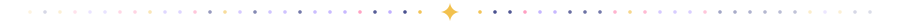</picture></p>

<h2 align="center">Roles I fit</h2>

<p align="center"><picture><source media="(prefers-color-scheme: dark)" srcset="assets/role-product-designer-dark.svg"><source media="(prefers-color-scheme: light)" srcset="assets/role-product-designer-light.svg"></picture> <picture><source media="(prefers-color-scheme: dark)" srcset="assets/role-design-engineer-dark.svg"><source media="(prefers-color-scheme: light)" srcset="assets/role-design-engineer-light.svg"></picture> <picture><source media="(prefers-color-scheme: dark)" srcset="assets/role-creative-technologist-dark.svg"><source media="(prefers-color-scheme: light)" srcset="assets/role-creative-technologist-light.svg"></picture> <picture><source media="(prefers-color-scheme: dark)" srcset="assets/role-interaction-designer-dark.svg"><source media="(prefers-color-scheme: light)" srcset="assets/role-interaction-designer-light.svg"></picture> <picture><source media="(prefers-color-scheme: dark)" srcset="assets/role-3d-artist-dark.svg"><source media="(prefers-color-scheme: light)" srcset="assets/role-3d-artist-light.svg"></picture> <picture><source media="(prefers-color-scheme: dark)" srcset="assets/role-founding-designer-dark.svg"><source media="(prefers-color-scheme: light)" srcset="assets/role-founding-designer-light.svg"></picture></p>

<details>
<summary>Why these roles</summary>

| Role | Why it fits |
|---|---|
| Product Designer | Core craft: flows, systems, polish |
| Design Engineer | Ships prototypes and Figma plugins in code |
| Creative Technologist | Works across AI, hardware and 3D |
| Interaction Designer (hardware) | Physical-digital interfaces |
| 3D Artist | Blender modelling, real-time scenes in Rive |
| Founding Designer | Founding member at Pulse, took it from 0 to a $1.5M seed |

</details>

<p align="center"><picture><source media="(prefers-color-scheme: dark)" srcset="assets/divider-dark.svg"><source media="(prefers-color-scheme: light)" srcset="assets/divider-light.svg"></picture></p>

<h2 align="center">About me</h2>

<table>
<tr>
<td width="62%" valign="middle">

> I take my notes from history and philosophy as much as from design.
>
> If you're not trying to create something beautiful, what's the point of being a designer?
>
> AI, hardware, software, a blank canvas: they're all just mediums.

</td>
<td width="38%" align="center" valign="middle"><picture><source media="(prefers-color-scheme: dark)" srcset="assets/metro-dark.svg"><source media="(prefers-color-scheme: light)" srcset="assets/metro-light.svg">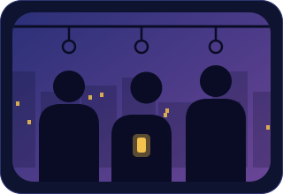</picture></td>
</tr>
</table>

<h3 align="center">Past roles and impact</h3>

<table>
<tr><th>Role</th><th>Impact</th></tr>
<tr><td width="38%" valign="top"><b>Media.net</b><br>Product Designer<br><sub>Oct 2025 – present</sub></td><td valign="top"><picture><source media="(prefers-color-scheme: dark)" srcset="assets/counter-plu-dark.svg"><source media="(prefers-color-scheme: light)" srcset="assets/counter-plu-light.svg"></picture> PLU conversion from the default-launcher onboarding redesign<br><picture><source media="(prefers-color-scheme: dark)" srcset="assets/counter-uninstalls-dark.svg"><source media="(prefers-color-scheme: light)" srcset="assets/counter-uninstalls-light.svg"></picture> fewer D0/D1 uninstalls<br><picture><source media="(prefers-color-scheme: dark)" srcset="assets/counter-search-dark.svg"><source media="(prefers-color-scheme: light)" srcset="assets/counter-search-light.svg"></picture> search engagement</td></tr>
<tr><td width="38%" valign="top"><b>Pulse</b><br>Founding Product Designer and Researcher<br><sub>Feb 2025 – Sep 2025</sub></td><td valign="top"><picture><source media="(prefers-color-scheme: dark)" srcset="assets/counter-seed-dark.svg"><source media="(prefers-color-scheme: light)" srcset="assets/counter-seed-light.svg"></picture> seed from Endiya Partners, led the design behind it<br><picture><source media="(prefers-color-scheme: dark)" srcset="assets/counter-customers-dark.svg"><source media="(prefers-color-scheme: light)" srcset="assets/counter-customers-light.svg"></picture> first enterprise customers<br><picture><source media="(prefers-color-scheme: dark)" srcset="assets/counter-poc-dark.svg"><source media="(prefers-color-scheme: light)" srcset="assets/counter-poc-light.svg"></picture> lead-to-PoC conversion</td></tr>
<tr><td width="38%" valign="top"><b>Titan Email (Directi)</b><br>Product Designer<br><sub>May 2023 – Jan 2025</sub></td><td valign="top"><picture><source media="(prefers-color-scheme: dark)" srcset="assets/counter-retention-dark.svg"><source media="(prefers-color-scheme: light)" srcset="assets/counter-retention-light.svg"></picture> retention from Link and File Tracking<br><picture><source media="(prefers-color-scheme: dark)" srcset="assets/counter-upgrades-dark.svg"><source media="(prefers-color-scheme: light)" srcset="assets/counter-upgrades-light.svg"></picture> plan upgrades in a month from Email Designer<br><picture><source media="(prefers-color-scheme: dark)" srcset="assets/counter-userbase-dark.svg"><source media="(prefers-color-scheme: light)" srcset="assets/counter-userbase-light.svg"></picture> user base, helped by partner migration flows<br>NPS <picture><source media="(prefers-color-scheme: dark)" srcset="assets/counter-nps-dark.svg"><source media="(prefers-color-scheme: light)" srcset="assets/counter-nps-light.svg"></picture> and <picture><source media="(prefers-color-scheme: dark)" srcset="assets/counter-rating-dark.svg"><source media="(prefers-color-scheme: light)" srcset="assets/counter-rating-light.svg"></picture> app store ratings</td></tr>
<tr><td width="38%" valign="top"><b>Trell, Titan, Zeta (Directi)</b><br>Design Intern<br><sub>2022 – 2023</sub></td><td valign="top">Web and mobile product work</td></tr>
</table>

<p align="center">~4 years of experience. B.Tech, IIT Patna (2019 – 2023). CEED All India Rank 105; JEE top 1 percentile.</p>

<details>
<summary>Impact as plain text</summary>

- **Media.net:** +7% PLU conversion from the default-launcher onboarding redesign; ~11% fewer D0/D1 uninstalls; +5% search engagement
- **Pulse:** led design behind a $1.5M seed from Endiya Partners; first 6 enterprise customers; 4x lead-to-PoC conversion
- **Titan Email:** +20% retention from Link and File Tracking; 100+ plan upgrades in a month from Email Designer; partner migration flows that helped 2x the user base; NPS 50+ and 4.5+ app store ratings

</details>

<h3 align="center">Disciplines</h3>

<table align="center">
<tr><td width="50%" align="center"><picture><source media="(prefers-color-scheme: dark)" srcset="assets/disc-product-dark.svg"><source media="(prefers-color-scheme: light)" srcset="assets/disc-product-light.svg">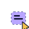</picture><br><b>Product design</b><br><sub>Flows, systems, polish</sub></td><td width="50%" align="center"><picture><source media="(prefers-color-scheme: dark)" srcset="assets/disc-engineering-dark.svg"><source media="(prefers-color-scheme: light)" srcset="assets/disc-engineering-light.svg">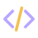</picture><br><b>Engineering</b><br><sub>Prototypes and Figma plugins, in code</sub></td></tr>
<tr><td width="50%" align="center"><picture><source media="(prefers-color-scheme: dark)" srcset="assets/disc-hardware-dark.svg"><source media="(prefers-color-scheme: light)" srcset="assets/disc-hardware-light.svg">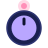</picture><br><b>Hardware interactions</b><br><sub>Physical-digital interfaces</sub></td><td width="50%" align="center"><picture><source media="(prefers-color-scheme: dark)" srcset="assets/disc-art-dark.svg"><source media="(prefers-color-scheme: light)" srcset="assets/disc-art-light.svg"></picture><br><b>Art (3D)</b><br><sub>Blender modelling, real-time scenes in Rive</sub></td></tr>
</table>

<p align="center"><picture><source media="(prefers-color-scheme: dark)" srcset="assets/divider-dark.svg"><source media="(prefers-color-scheme: light)" srcset="assets/divider-light.svg"></picture></p>

<h2 align="center">Work highlights</h2>

<table>
<tr>
<td width="50%" valign="top"><a href="https://sajalkumar.com/email-designer"><picture><source media="(prefers-color-scheme: dark)" srcset="assets/card-titan-dark.svg"><source media="(prefers-color-scheme: light)" srcset="assets/card-titan-light.svg"></picture></a><h3>Titan Email (Directi)</h3><p>Designed Email Designer (a block-based email builder), Link and File Tracking (Titan's top monetisation feature) and partner migration flows for GoDaddy.</p><p><b>Key result.</b> +20% retention; 100+ upgrades in a month; migration flows helped 2x the user base. Work I contributed to: Titan's GoDaddy pilot saw +76% ARPU, +39% trial-to-paid, 9x premium upgrades and a 65% NPS improvement (Titan's case study of the four-month pilot, as of Aug 2025).</p><p><a href="https://sajalkumar.com/email-designer">Email Designer case study</a> · <a href="https://sajalkumar.com/link-and-file-tracking">Tracking case study</a> · <a href="https://titan.email/go-daddy-partners-with-titan/">GoDaddy case study</a> · <a href="https://titan.email">Titan</a></p></td>
<td width="50%" valign="top"><a href="https://sajalkumar.com/pulse"><picture><source media="(prefers-color-scheme: dark)" srcset="assets/card-pulse-dark.svg"><source media="(prefers-color-scheme: light)" srcset="assets/card-pulse-light.svg"></picture></a><h3>Pulse</h3><p>AI-native product intelligence and feedback triaging, built around agentic workflows. Led end-to-end design as a founding member.</p><p><b>Key result.</b> $1.5M seed from Endiya Partners; 6 enterprise customers (Zluri, Yellow AI, BrowserStack, MoEngage, Whatfix); 4x lead-to-PoC.</p><p><a href="https://sajalkumar.com/pulse">Case study</a></p></td>
</tr>
</table>

<p align="center"><picture><source media="(prefers-color-scheme: dark)" srcset="assets/divider-dark.svg"><source media="(prefers-color-scheme: light)" srcset="assets/divider-light.svg"></picture></p>

<h2 align="center">Solo side quests</h2>

<table>
<tr>
<td width="50%" valign="top"><a href="https://sajalkumar.com/tiny"><picture><source media="(prefers-color-scheme: dark)" srcset="assets/card-tiny-dark.svg"><source media="(prefers-color-scheme: light)" srcset="assets/card-tiny-light.svg"></picture></a><h3>Tiny</h3><p><b>A plant you can talk to.</b> A multimodal, interactive plant experience.</p><p><a href="https://sajalkumar.com/tiny">Case study</a></p></td>
<td width="50%" valign="top"><a href="https://github.com/theanimatedmonk/birdie"><picture><source media="(prefers-color-scheme: dark)" srcset="assets/card-birdie-dark.svg"><source media="(prefers-color-scheme: light)" srcset="assets/card-birdie-light.svg"></picture></a><h3>Birdie</h3><p><b>A wildlife finder.</b> An ESP32 microphone on the balcony streams audio to BirdNET, and each bird it hears shows up as an animated Rive card, with a radar and a logbook.</p><p><a href="https://github.com/theanimatedmonk/birdie">Repo</a></p></td>
</tr>
</table>

<p align="center">More: <a href="https://sajalkumar.com/product-experiments">utility tools and experiments</a>.</p>

<p align="center"><picture><source media="(prefers-color-scheme: dark)" srcset="assets/divider-dark.svg"><source media="(prefers-color-scheme: light)" srcset="assets/divider-light.svg"></picture></p>

<h2 align="center">Contact</h2>

<p align="center"><picture><source media="(prefers-color-scheme: dark)" srcset="assets/terminal-dark.svg"><source media="(prefers-color-scheme: light)" srcset="assets/terminal-light.svg"></picture></p>

```json
{
  "name": "Sajal Kumar",
  "role": "Designer and builder",
  "email": "isajalkumar247@gmail.com",
  "website": "https://sajalkumar.com",
  "socials": {
    "x": "https://x.com/deanimatedmonk",
    "linkedin": "https://www.linkedin.com/in/sajalkumar247/",
    "github": "https://github.com/theanimatedmonk"
  }
}
```

<p align="center"><a href="https://x.com/deanimatedmonk"><picture><source media="(prefers-color-scheme: dark)" srcset="assets/icon-x-dark.svg"><source media="(prefers-color-scheme: light)" srcset="assets/icon-x-light.svg"></picture></a> <a href="https://x.com/deanimatedmonk">X</a>&nbsp;&nbsp;<a href="https://www.linkedin.com/in/sajalkumar247/"><picture><source media="(prefers-color-scheme: dark)" srcset="assets/icon-linkedin-dark.svg"><source media="(prefers-color-scheme: light)" srcset="assets/icon-linkedin-light.svg"></picture></a> <a href="https://www.linkedin.com/in/sajalkumar247/">LinkedIn</a>&nbsp;&nbsp;<a href="https://github.com/theanimatedmonk"><picture><source media="(prefers-color-scheme: dark)" srcset="assets/icon-github-dark.svg"><source media="(prefers-color-scheme: light)" srcset="assets/icon-github-light.svg"></picture></a> <a href="https://github.com/theanimatedmonk">GitHub</a></p>

<p align="center"><picture><source media="(prefers-color-scheme: dark)" srcset="assets/divider-dark.svg"><source media="(prefers-color-scheme: light)" srcset="assets/divider-light.svg"></picture></p>

<p align="center"><picture><source media="(prefers-color-scheme: dark)" srcset="assets/footer-dark.svg"><source media="(prefers-color-scheme: light)" srcset="assets/footer-light.svg"></picture></p>
