<!-- Written by tools/build.py; edit that. -->
<p align="center"><picture><source media="(prefers-color-scheme: dark)" srcset="assets/hero-dark.gif"><source media="(prefers-color-scheme: light)" srcset="assets/hero-light.gif">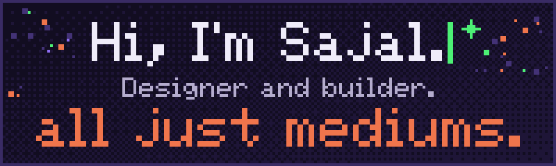</picture></p>

<p align="center"><b>Designer and builder.</b> AI, hardware, software, a blank canvas: they're all just mediums.<br><a href="https://sajalkumar.com">sajalkumar.com</a></p>

<p align="center">. . . . : : : * : : : . . . .</p>

<h2 align="center">Roles I fit</h2>

```text
+------------------+  +-----------------+  +-----------------------+
| Product Designer |  | Design Engineer |  | Creative Technologist |
+------------------+  +-----------------+  +-----------------------+
+---------------------------------+  +-----------+  +-------------------+
| Interaction Designer (hardware) |  | 3D Artist |  | Founding Designer |
+---------------------------------+  +-----------+  +-------------------+
```

<details>
<summary>Why these roles</summary>

| Role | Why it fits |
|---|---|
| Product Designer | Core craft: flows, systems, polish |
| Design Engineer | Ships prototypes and Figma plugins in code |
| Creative Technologist | Works across AI, hardware and 3D |
| Interaction Designer (hardware) | Physical-digital interfaces |
| 3D Artist | Blender modelling, real-time scenes in Rive |
| Founding Designer | Founding member at Pulse, took it from 0 to a $1.5M seed |

</details>

<p align="center">. . . . : : : * : : : . . . .</p>

<h2 align="center">About me</h2>

<table>
<tr>
<td width="62%" valign="middle">

> I take my notes from history and philosophy as much as from design.
>
> If you're not trying to create something beautiful, what's the point of being a designer?
>
> AI, hardware, software, a blank canvas: they're all just mediums.

</td>
<td width="38%" align="center" valign="middle"><picture><source media="(prefers-color-scheme: dark)" srcset="assets/metro-dark.gif"><source media="(prefers-color-scheme: light)" srcset="assets/metro-light.gif">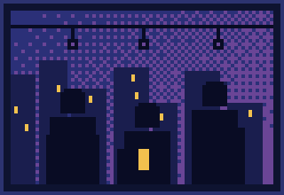</picture></td>
</tr>
</table>

<h3 align="center">Past roles and impact</h3>

<table>
<tr><th>Role</th><th>Impact</th></tr>
<tr><td width="38%" valign="top"><b>Media.net</b><br>Product Designer<br><sub>Oct 2025 – present</sub></td><td valign="top"><b>+7%</b> PLU conversion from the default-launcher onboarding redesign<br><b>~11%</b> fewer D0/D1 uninstalls<br><b>+5%</b> search engagement</td></tr>
<tr><td width="38%" valign="top"><b>Pulse</b><br>Founding Product Designer and Researcher<br><sub>Feb 2025 – Sep 2025</sub></td><td valign="top"><b>$1.5M</b> seed from Endiya Partners, led the design behind it<br><b>6</b> first enterprise customers<br><b>4x</b> lead-to-PoC conversion</td></tr>
<tr><td width="38%" valign="top"><b>Titan Email (Directi)</b><br>Product Designer<br><sub>May 2023 – Jan 2025</sub></td><td valign="top"><b>+20%</b> retention from Link and File Tracking<br><b>100+</b> plan upgrades in a month from Email Designer<br><b>2x</b> user base, helped by partner migration flows<br>NPS <b>50+</b> and <b>4.5+</b> app store ratings</td></tr>
<tr><td width="38%" valign="top"><b>Trell, Titan, Zeta (Directi)</b><br>Design Intern<br><sub>2022 – 2023</sub></td><td valign="top">Web and mobile product work</td></tr>
</table>

<p align="center">~4 years of experience. B.Tech, IIT Patna (2019 – 2023). CEED All India Rank 105; JEE top 1 percentile.</p>

<h3 align="center">Disciplines</h3>

<table align="center">
<tr><td width="50%" align="center"><picture><source media="(prefers-color-scheme: dark)" srcset="assets/disc-product-dark.gif"><source media="(prefers-color-scheme: light)" srcset="assets/disc-product-light.gif">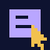</picture><br><b>Product design</b><br><sub>Flows, systems, polish</sub></td><td width="50%" align="center"><picture><source media="(prefers-color-scheme: dark)" srcset="assets/disc-engineering-dark.gif"><source media="(prefers-color-scheme: light)" srcset="assets/disc-engineering-light.gif">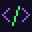</picture><br><b>Engineering</b><br><sub>Prototypes and Figma plugins, in code</sub></td></tr>
<tr><td width="50%" align="center"><picture><source media="(prefers-color-scheme: dark)" srcset="assets/disc-hardware-dark.gif"><source media="(prefers-color-scheme: light)" srcset="assets/disc-hardware-light.gif">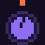</picture><br><b>Hardware interactions</b><br><sub>Physical-digital interfaces</sub></td><td width="50%" align="center"><picture><source media="(prefers-color-scheme: dark)" srcset="assets/disc-art-dark.gif"><source media="(prefers-color-scheme: light)" srcset="assets/disc-art-light.gif"></picture><br><b>Art (3D)</b><br><sub>Blender modelling, real-time scenes in Rive</sub></td></tr>
</table>

<p align="center">. . . . : : : * : : : . . . .</p>

<h2 align="center">Work highlights</h2>

<table>
<tr>
<td width="50%" valign="top"><a href="https://sajalkumar.com/email-designer"><picture><source media="(prefers-color-scheme: dark)" srcset="assets/card-titan-dark.gif"><source media="(prefers-color-scheme: light)" srcset="assets/card-titan-light.gif">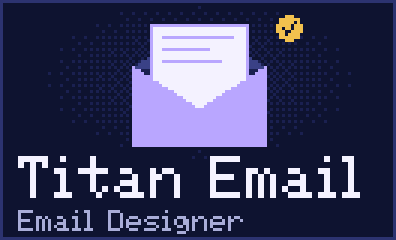</picture></a><h3>Titan Email (Directi)</h3><p>Designed Email Designer (a block-based email builder), Link and File Tracking (Titan's top monetisation feature) and partner migration flows for GoDaddy.</p><p><b>Key result.</b> +20% retention; 100+ upgrades in a month; migration flows helped 2x the user base. Work I contributed to: Titan's GoDaddy pilot saw +76% ARPU, +39% trial-to-paid, 9x premium upgrades and a 65% NPS improvement (Titan's case study of the four-month pilot, as of Aug 2025).</p><p><a href="https://sajalkumar.com/email-designer">Email Designer case study</a> · <a href="https://sajalkumar.com/link-and-file-tracking">Tracking case study</a> · <a href="https://titan.email/go-daddy-partners-with-titan/">GoDaddy case study</a> · <a href="https://titan.email">Titan</a></p></td>
<td width="50%" valign="top"><a href="https://sajalkumar.com/pulse"><picture><source media="(prefers-color-scheme: dark)" srcset="assets/card-pulse-dark.gif"><source media="(prefers-color-scheme: light)" srcset="assets/card-pulse-light.gif">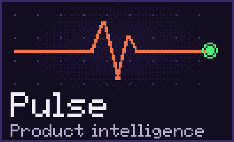</picture></a><h3>Pulse</h3><p>AI-native product intelligence and feedback triaging, built around agentic workflows. Led end-to-end design as a founding member.</p><p><b>Key result.</b> $1.5M seed from Endiya Partners; 6 enterprise customers (Zluri, Yellow AI, BrowserStack, MoEngage, Whatfix); 4x lead-to-PoC.</p><p><a href="https://sajalkumar.com/pulse">Case study</a></p></td>
</tr>
</table>

<p align="center">. . . . : : : * : : : . . . .</p>

<h2 align="center">Solo side quests</h2>

<table>
<tr>
<td width="50%" valign="top"><a href="https://sajalkumar.com/tiny"><picture><source media="(prefers-color-scheme: dark)" srcset="assets/card-tiny-dark.gif"><source media="(prefers-color-scheme: light)" srcset="assets/card-tiny-light.gif">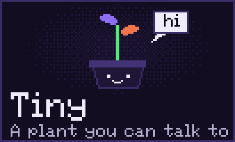</picture></a><h3>Tiny</h3><p><b>A plant you can talk to.</b> A multimodal, interactive plant experience.</p><p><a href="https://sajalkumar.com/tiny">Case study</a></p></td>
<td width="50%" valign="top"><a href="https://github.com/theanimatedmonk/birdie"><picture><source media="(prefers-color-scheme: dark)" srcset="assets/card-birdie-dark.gif"><source media="(prefers-color-scheme: light)" srcset="assets/card-birdie-light.gif">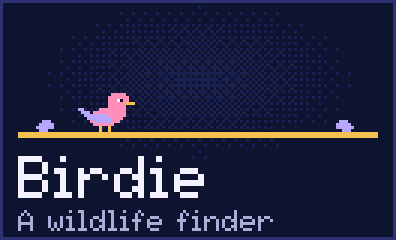</picture></a><h3>Birdie</h3><p><b>A wildlife finder.</b> An ESP32 microphone on the balcony streams audio to BirdNET, and each bird it hears shows up as an animated Rive card, with a radar and a logbook.</p><p><a href="https://github.com/theanimatedmonk/birdie">Repo</a></p></td>
</tr>
</table>

<p align="center">More: <a href="https://sajalkumar.com/product-experiments">utility tools and experiments</a>.</p>

<p align="center">. . . . : : : * : : : . . . .</p>

<h2 align="center">Contact</h2>

<p align="center"><picture><source media="(prefers-color-scheme: dark)" srcset="assets/terminal-dark.gif"><source media="(prefers-color-scheme: light)" srcset="assets/terminal-light.gif">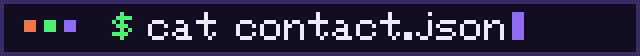</picture></p>

```json
{
  "name": "Sajal Kumar",
  "role": "Designer and builder",
  "email": "isajalkumar247@gmail.com",
  "website": "https://sajalkumar.com",
  "socials": {
    "x": "https://x.com/deanimatedmonk",
    "linkedin": "https://www.linkedin.com/in/sajalkumar247/",
    "github": "https://github.com/theanimatedmonk"
  }
}
```

<p align="center"><a href="https://x.com/deanimatedmonk">X</a> / <a href="https://www.linkedin.com/in/sajalkumar247/">LinkedIn</a> / <a href="https://github.com/theanimatedmonk">GitHub</a></p>

<p align="center">. . . . : : : * : : : . . . .</p>

<p align="center"><picture><source media="(prefers-color-scheme: dark)" srcset="assets/footer-dark.gif"><source media="(prefers-color-scheme: light)" srcset="assets/footer-light.gif">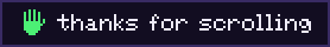</picture></p>
